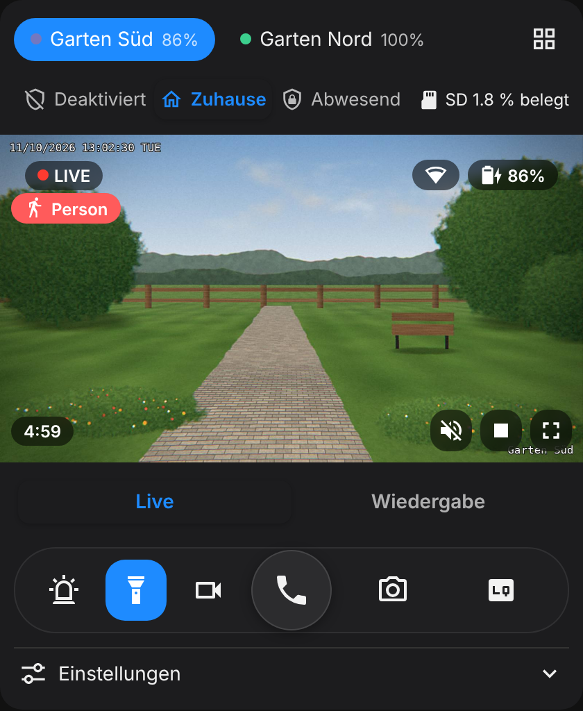
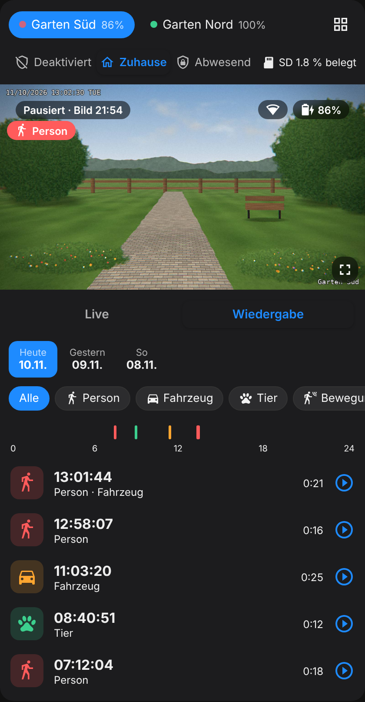
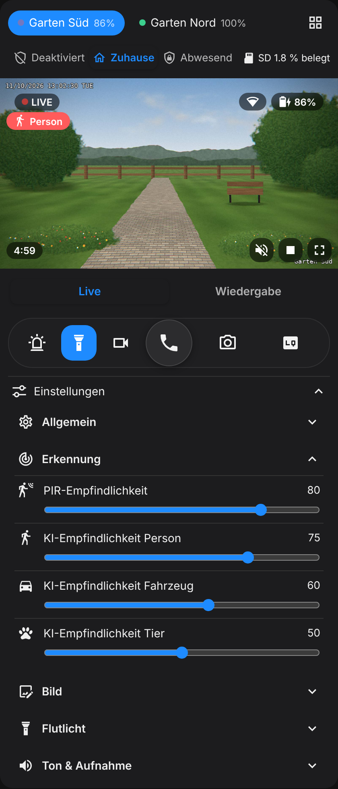
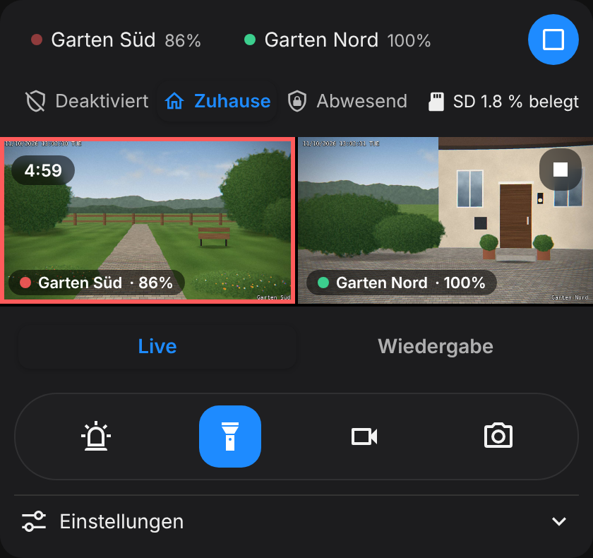
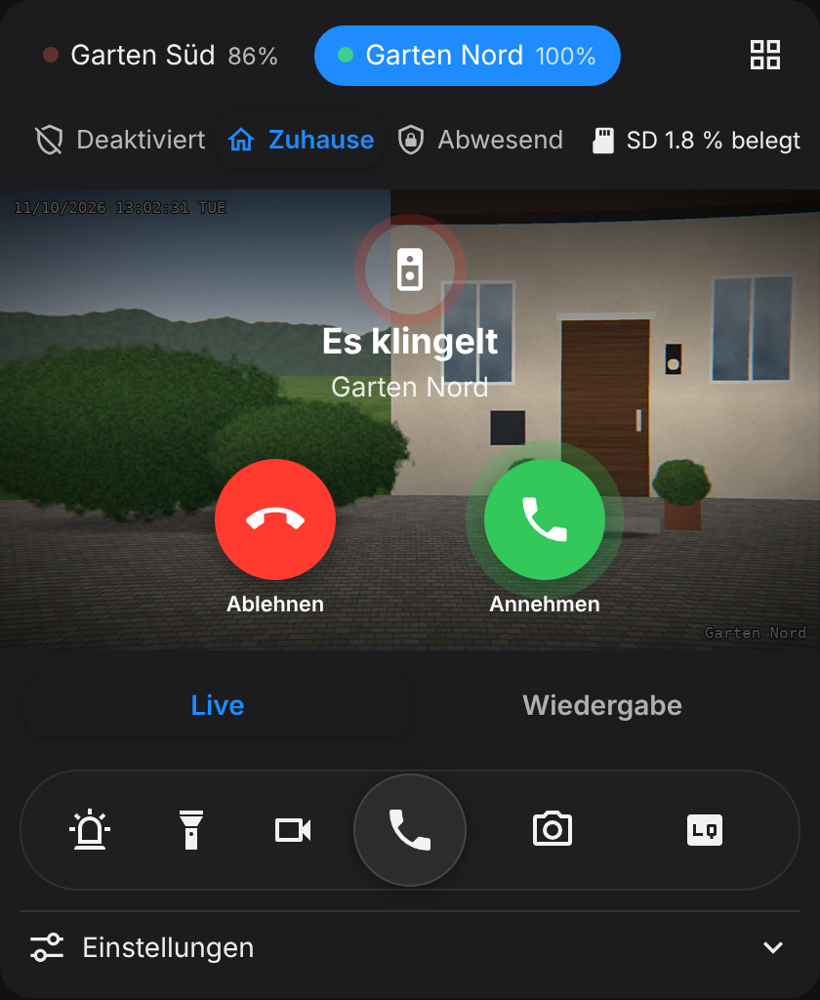

# Reolink App Card

[English](README.md) · **Deutsch** · [Français](README.fr.md)

[](https://buymeacoffee.com/nion_zh)

Eine Lovelace-Karte für Home Assistant, die sich wie die offizielle Reolink-App anfühlt: Livebild, Steuerung, Einstellungen und Wiedergabe der SD-Karten-Aufnahmen in einer Karte. Gebaut für Reolink-Kameras (z. B. die akkubetriebene Argus-Serie) an einem **Reolink Home Hub**, über die offizielle [Reolink-Integration](https://www.home-assistant.io/integrations/reolink/).

> [!IMPORTANT]
> **Nur mit Reolink Home Hub.** Die Karte funktioniert nur mit Kameras, die an einem Reolink Home Hub (oder Home Hub Pro) angemeldet sind und über den Hub in Home Assistant eingebunden wurden. Kameras, die ohne Hub direkt in Home Assistant eingebunden sind, werden nicht unterstützt.

<p>
  
  
  
</p>

<sub>Screenshots mit einem gezeichneten Demo-Bild statt einer echten Kamera.</sub>

## Funktionen

- **Echtes Livebild:** startet automatisch, sobald die Karte sichtbar ist, und pausiert nach 5 Minuten (einstellbar) oder sofort, wenn du wegscrollst oder die App verlässt.
- **Schonende Vorschau:** Im pausierten Zustand zeigt die Karte das letzte Bild als Standbild, statt die Akkukamera ständig neu abzufragen.
- **Ton:** Der Lautsprecher-Button im Bild schaltet den Ton der Kamera ein und aus. Mit `audio: auto` ist der Ton an, sobald das Livebild läuft.
- **Gegensprechen:** direkt aus der Karte durch die Kamera sprechen, mit Hörer-Button und Gesprächsansicht wie in der Reolink-App (Labs-Funktion von Home Assistant, siehe Hinweise).
- **Klingel:** für eine Reolink-Klingel oder eine Kamera, die du als Klingel nutzt: Beim Klingeln erscheint eine Anrufansicht mit Ablehnen und Annehmen. Annehmen startet das Gegensprechen.
- **Schwenken & Neigen (PTZ):** Steuerkreuz, Zoom und gespeicherte Positionen für schwenkbare Kameras.
- **Öffnen aus einer Mitteilung:** Ein Link in deiner Push-Mitteilung öffnet die richtige Kamera live oder spielt die passende Aufnahme ab.
- **Steuerleiste wie in der Reolink-App:** Sprechen, Ton-Alarm, Spotlight, Aufnahme, Schnappschuss und Qualität (Flüssig, Balanciert, Klar). Die gewählte Qualität merkt sich jedes Gerät.
- **Modus-Auswahl oben:** entweder der Reolink-Szenenmodus des Hubs (Deaktiviert / Zuhause / Abwesend) oder ein eigener Modus aus Home Assistant (`mode_entity`), etwa für Push-Benachrichtigungen. Dazu die Belegung der SD-Karte.
- **Automatischer Sprung bei Erkennung:** Erkennt eine Kamera eine Person, ein Fahrzeug oder ein Tier, wechselt die Karte dorthin und zeigt einen Hinweis.
- **Alle Kameras gleichzeitig:** Rasteransicht mit allen Livebildern; ein Tipp öffnet die Kamera.
- **Digitaler Zoom:** mit zwei Fingern zoomen, doppeltippen zum Vergrössern, mit dem Mausrad bei gedrückter Ctrl-Taste.
- **Einstellungen in Gruppen:** Allgemein, Erkennung (PIR- und KI-Empfindlichkeit), Bild (Helligkeit, Kontrast, Sättigung, Schärfe), Flutlicht, Ton & Aufnahme – mit Reglern und Auswahllisten.
- **Wiedergabe:** Tagesauswahl, Filter nach Ereignistyp, farbige 24-Stunden-Zeitleiste, Geschwindigkeit (0,5× bis 4×), nächster Clip automatisch, Clip herunterladen.
- **Akku-Warnung:** Hinweis bei schwachem Akku und bei zu hoher oder zu tiefer Batterietemperatur.
- **Visueller Editor:** Kameras werden automatisch erkannt und lassen sich per Klick hinzufügen.
- **Kartenvorschläge:** Bei *Zum Dashboard hinzufügen* an einer Reolink-Kamera (oder am Hub) erscheint die Karte unter den Community-Vorschlägen, fertig eingerichtet.
- **Englisch, Deutsch und Französisch,** passend zur Sprache von Home Assistant.

Einträge für Entitäten, die es nicht gibt oder die deaktiviert sind, blendet die Karte automatisch aus.

<p>
  
  
</p>

## Installation

[](https://my.home-assistant.io/redirect/hacs_repository/?owner=niondevelop&repository=reolink-app-card&category=plugin)

### Über den Marketplace bzw. HACS

1. **Einstellungen → Marketplace** öffnen (ab Home Assistant 2026.11; davor in **HACS**)
2. Nach „Reolink App Card“ suchen und **Installieren**
3. Browser neu laden (in der Companion-App: Einstellungen → *Frontend-Cache zurücksetzen*)

Falls die Karte in der Suche noch nicht auftaucht, lässt sie sich selbst hinzufügen: im Marketplace oben rechts **Über Link hinzufügen** (*Add from link*) wählen, `niondevelop/reolink-app-card` eintragen und **Hinzufügen** (beim ersten Mal fragt der Marketplace nach einer Verbindung mit GitHub). Bei älteren Versionen mit HACS: Menü oben rechts → **Benutzerdefinierte Repositories**, Typ **Dashboard**. Sobald die Karte im Katalog ist, stellt der Marketplace von selbst um.

Der Marketplace legt die Dashboard-Ressource selbst an (`/local/community/reolink-app-card/reolink-app-card.js`). Wer die Ressourcen in YAML pflegt, trägt sie dort selbst ein.

### Manuelle Installation

`dist/reolink-app-card.js` nach `/config/www/` kopieren und unter **Einstellungen → Dashboards → Ressourcen** als JavaScript-Modul mit der URL `/local/reolink-app-card.js` hinzufügen.

## Konfiguration

Am einfachsten über den visuellen Editor: Karte hinzufügen → „Reolink App Card“. Oder in YAML:

```yaml
type: custom:reolink-app-card
cameras:
  - name: Eingang
    entity: camera.kamera_eingang_standardauflosung
  - name: Garten
    entity: camera.kamera_garten_standardauflosung
```

### Karten-Optionen

| Option                    | Standard      | Beschreibung |
| ------------------------- | ------------- | ------------ |
| `cameras`                 | –             | **Pflicht.** Liste der Kameras (siehe unten) |
| `audio`                   | `manual`      | Audioausgabe: `manual` (Livebild startet stumm, Ton über den Lautsprecher-Button) oder `auto` (Ton an, sobald das Livebild läuft; Browser erlauben das erst, nachdem du einmal auf die Seite getippt hast) |
| `default_quality`         | `fluent`      | Startqualität: `fluent` (Flüssig), `balanced` (Balanciert) oder `clear` (Klar) |
| `live_timeout`            | `300`         | Sekunden, nach denen das Livebild pausiert. `0` = kein Limit |
| `auto_live`               | `true`        | Livebild automatisch starten, sobald die Karte sichtbar ist |
| `auto_switch`             | `true`        | Bei einer Erkennung automatisch zur betroffenen Kamera springen |
| `alert_seconds`           | `8`           | Wie lange der Erkennungs-Hinweis sichtbar bleibt |
| `autoplay_next`           | `true`        | Nach dem Ende eines Clips den nächsten abspielen |
| `battery_warning`         | `20`          | Akku-Warnung ab diesem Ladestand (%). `0` = aus |
| `temperature_warning`     | `45`          | Warnung bei Batterietemperatur ab (°C). `false` = aus |
| `temperature_low_warning` | `-10`         | Warnung bei Batterietemperatur bis (°C). `false` = aus |
| `mode_entity`             | –             | Eigene Modus-Auswahl oben in der Karte, z. B. ein `input_select` mit „Abwesend / Zuhause / Nacht / Aus“ für deine Benachrichtigungs-Automation. Ersetzt dort den Reolink-Szenenmodus |
| `mode_icons`              | –             | Eigene Symbole je Option, z. B. `{ Nacht: mdi:weather-night }`. Ohne Angabe wählt die Karte passende Symbole für typische Namen |
| `show_scene`              | `true` / `false` mit `mode_entity` | Reolink-Szenenmodus des Hubs anzeigen |
| `show_hub`                | `true`        | Hub-Zeile (Szenenmodus und SD-Karte) anzeigen |
| `hub_prefix`              | automatisch   | Gemeinsamer Teil der Hub-Entity-IDs. Nur nötig, wenn der Hub nicht automatisch gefunden wird |
| `hub_entities`            | –             | Hub-Entitäten einzeln setzen: `scene`, `storage` |
| `language`                | `auto`        | `auto`, `en`, `de` oder `fr` |
| `doorbell_timeout`        | `30`          | Wie lange die Anrufansicht der Klingel bleibt (Sekunden) |
| `doorbell_sound`          | `true`        | Beim Klingeln einen kurzen Klingelton auf dem Gerät abspielen |
| `talk_url`                | –             | Optional: Link, den der Sprechen-Button öffnet (z. B. die Reolink-App), wenn Gegensprechen nicht verfügbar ist. Auch pro Kamera möglich |

### Kamera-Optionen

| Option       | Beschreibung |
| ------------ | ------------ |
| `entity`     | **Pflicht** (oder `prefix`). Ein beliebiger Stream der Kamera, z. B. `camera.kamera_eingang_standardauflosung`. Daraus findet die Karte alle weiteren Entitäten der Kamera |
| `prefix`     | Alternative zu `entity`: der gemeinsame Teil der Entity-IDs, z. B. `kamera_eingang` für `camera.kamera_eingang_standardauflosung` |
| `name`       | Angezeigter Name |
| `media_name` | Name der Kamera in der Reolink-Medienquelle (Medien → Reolink). Nötig für die Wiedergabe, wenn er vom Gerätenamen abweicht |
| `talk_url`   | Link für den Sprechen-Button dieser Kamera, wenn Gegensprechen nicht verfügbar ist |
| `doorbell`   | Was bei dieser Kamera klingelt: ein beliebiger Binärsensor, Taster, Schalter, Helfer oder ein Ereignis. Ohne Angabe wird der Besucher-Sensor einer Reolink-Klingel genommen, falls vorhanden. `false` schaltet es ab |
| `entities`   | Einzelne Entitäten überschreiben, z. B. `entities: { light: light.mein_flutlicht }` |

Die Karte findet die Entitäten selbst über das Geräteregister, also in jeder Sprache und auch bei umbenannten Entitäten. Geht das nicht, sucht sie über deutsche und englische Entity-IDs (z. B. `camera.<prefix>_standardauflosung` oder `camera.<prefix>_fluent`). Mit `entities` lässt sich jede einzeln setzen. Die Schlüssel sind: `cam_sd`, `cam_bal`, `cam_hd`, `snap`, `light`, `siren`, `manual_rec`, `rec`, `pir`, `push`, `daynight`, `battery`, `battery_state`, `battery_temp`, `wifi`, `sleep`, `det_person`, `det_vehicle`, `det_animal`, `det_motion` sowie die Einstellungen `pir_sens`, `ai_person`, `ai_vehicle`, `ai_animal`, `img_bright`, `img_contrast`, `img_sat`, `img_sharp`, `anti_flicker`, `ir_bright`, `fl_mode`, `fl_bright`, `volume`, `post_rec` u. a.

### Aus einer Mitteilung öffnen

Diese Angaben an den Dashboard-Link deiner Mitteilung hängen:

| Angabe | Bedeutung |
| ------ | --------- |
| `rac=live` | Kamera wählen und das Livebild starten |
| `rac=event` | Die Aufnahme zum Zeitpunkt der Mitteilung abspielen |
| `rac=talk` | Livebild starten und gleich das Gegensprechen einschalten, z. B. für einen Knopf **Annehmen** |
| `rac_cam` | Die Kamera: ihre Entität, `prefix` oder ihr Name |
| `rac_t` | Zeitpunkt als Unix-Zeitstempel (für `rac=event`; Standard: jetzt) |

Speichert die Kamera die Aufnahme noch, versucht es die Karte einige Minuten lang erneut. Beispiel für die Android-Companion-App, mit zwei Knöpfen:

```yaml
action: notify.mobile_app_mein_handy
data:
  title: Person beim Eingang
  message: "{{ now().strftime('%H:%M') }}"
  data:
    image: /api/camera_proxy/camera.kamera_eingang_schnappschusse_in_standardauflosung
    clickAction: "/dashboard-kameras/0?rac=live&rac_cam=camera.kamera_eingang_standardauflosung"
    actions:
      - action: URI
        title: Live
        uri: "/dashboard-kameras/0?rac=live&rac_cam=camera.kamera_eingang_standardauflosung"
      - action: URI
        title: Aufnahme
        uri: "/dashboard-kameras/0?rac=event&rac_cam=camera.kamera_eingang_standardauflosung&rac_t={{ as_timestamp(now()) | int }}"
```

Auf iPhones statt `clickAction` die Angabe `url` verwenden; die `actions` funktionieren gleich.

#### Vollständiges Beispiel: Alarm-Mitteilung mit Kamerabildern

Löst die Alarmanlage aus, schickt jede Kamera eine eigene Mitteilung mit aktuellem Bild und den Knöpfen **Live** und **Aufnahme**. Ein Tipp auf die Mitteilung selbst öffnet die Kamera live. Entity-IDs, die Mitteilungs-Aktion deines Handys und den Dashboard-Pfad (hier `/dashboard-kameras/kameras`) durch deine eigenen ersetzen; für ein zweites Handy die beiden Aktionen kopieren und die Mitteilungs-Aktion anpassen.

```yaml
alias: Alarm-Mitteilung mit Kamerabildern
description: Schickt pro Kamera eine Mitteilung mit Bild und Knöpfen für Livebild und Aufnahme.
triggers:
  - trigger: state
    entity_id: alarm_control_panel.alarmanlage
    to: triggered
actions:
  - action: notify.mobile_app_mein_handy
    data:
      title: "🚨 Alarm ausgelöst"
      message: "Eingang · {{ now().strftime('%H:%M') }}"
      data:
        image: /api/camera_proxy/camera.kamera_eingang_schnappschusse_in_standardauflosung
        clickAction: "/dashboard-kameras/kameras?rac=live&rac_cam=kamera_eingang"
        tag: alarm-eingang
        group: alarm
        channel: Alarm
        importance: max
        priority: high
        ttl: 0
        actions:
          - action: URI
            title: Live
            uri: "/dashboard-kameras/kameras?rac=live&rac_cam=kamera_eingang"
          - action: URI
            title: Aufnahme
            uri: "/dashboard-kameras/kameras?rac=event&rac_cam=kamera_eingang&rac_t={{ as_timestamp(now()) | int }}"
  - action: notify.mobile_app_mein_handy
    data:
      title: "🚨 Alarm ausgelöst"
      message: "Garten · {{ now().strftime('%H:%M') }}"
      data:
        image: /api/camera_proxy/camera.kamera_garten_schnappschusse_in_standardauflosung
        clickAction: "/dashboard-kameras/kameras?rac=live&rac_cam=kamera_garten"
        tag: alarm-garten
        group: alarm
        channel: Alarm
        importance: max
        priority: high
        ttl: 0
        actions:
          - action: URI
            title: Live
            uri: "/dashboard-kameras/kameras?rac=live&rac_cam=kamera_garten"
          - action: URI
            title: Aufnahme
            uri: "/dashboard-kameras/kameras?rac=event&rac_cam=kamera_garten&rac_t={{ as_timestamp(now()) | int }}"
mode: single
max_exceeded: silent
```

Hinweise:
- `rac_cam` nimmt den `prefix` der Kamera wie in der Kartenkonfiguration (hier `kamera_eingang` und `kamera_garten`), eine Kamera-Entität oder den Kameranamen.
- Ein eigener `tag` pro Kamera sorgt dafür, dass beide Mitteilungen bleiben, statt sich gegenseitig zu ersetzen; mit `channel: Alarm` und `importance: max` lässt sich Alarm-Mitteilungen unter Android ein eigener Ton geben.
- Die Schnappschuss-Entität (`..._schnappschusse_in_standardauflosung`) ist in der Reolink-Integration ab Werk deaktiviert; auf der Geräteseite aktivieren oder stattdessen die Stream-Entität nehmen.

### Kamera-Modus und Blueprints

Die Karte kann oben einen eigenen Modus zeigen, z. B. **Abwesend / Zuhause / Nacht / Aus**, und deine Automationen entscheiden, was in welchem Modus passiert. Zwei Blueprints machen das Einrichten einfach:

1. **Modus-Helfer anlegen:** *Einstellungen → Geräte & Dienste → Helfer → Helfer erstellen → Dropdown*, Name z. B. „Kamera-Modus“, Optionen `Abwesend`, `Zuhause`, `Nacht`, `Aus`.
2. **In der Karte anzeigen:** im Karten-Editor unter *Optionen → Modus-Auswahl oben*, oder `mode_entity: input_select.kamera_modus` in YAML. Für diese Namen wählt die Karte passende Symbole; eigene lassen sich mit `mode_icons` setzen.
3. **Blueprints importieren** und daraus je eine Automation erstellen:

| Blueprint | Was er macht | |
| --------- | ------------ | - |
| Kamera-Benachrichtigung nach Modus | Erkennt eine Kamera etwas (z. B. eine Person), kommt eine Mitteilung mit Bild und den Knöpfen **Live** und **Aufnahme**, aber nur in den gewählten Modi, z. B. Abwesend und Nacht. Eine Automation pro Kamera | [](https://my.home-assistant.io/redirect/blueprint_import/?blueprint_url=https%3A%2F%2Fgithub.com%2Fniondevelop%2Freolink-app-card%2Fblob%2Fmain%2Fblueprints%2Fautomation%2Freolink_app_card%2Fcamera_notification_by_mode.yaml) |
| Kamera-Modus automatisch | **Abwesend**, wenn alle weg sind, **Zuhause** oder **Nacht** beim Heimkommen, und Zuhause ↔ Nacht zu den eingestellten Nachtzeiten | [](https://my.home-assistant.io/redirect/blueprint_import/?blueprint_url=https%3A%2F%2Fgithub.com%2Fniondevelop%2Freolink-app-card%2Fblob%2Fmain%2Fblueprints%2Fautomation%2Freolink_app_card%2Fcamera_mode_automatic.yaml) |

Beide brauchen Home Assistant 2026.7 oder neuer. Die Blueprints sind auf Englisch voreingestellt (*Away / Home / Night*); bei einem deutschen Helfer im Blueprint die Namen `Abwesend`, `Zuhause` und `Nacht` eintragen und bei den Knöpfen z. B. „Aufnahme“ statt „Recording“. Der Modus **Aus** wird nie automatisch gesetzt; ihn wählst du in der Karte, wenn du keine Mitteilungen willst.

### Farbe anpassen

Die Akzentfarbe kommt aus der CSS-Variable `--reolink-accent` (Standard `#1e8bff`) und lässt sich im Theme setzen.

## Hinweise

- **Entitäten aktivieren:** Viele Reolink-Entitäten sind ab Werk deaktiviert, z. B. die Qualitätsstufen „Ausgewogen“ und „Hochauflösung“, die Bildeinstellungen und der SD-Sensor des Hubs. Unter *Einstellungen → Geräte & Dienste → Reolink → Gerät* lassen sie sich aktivieren; danach erscheinen sie in der Karte.
- **Akku:** Jede Minute Livebild kostet Akku. Wer sparen will, verkürzt `live_timeout` oder setzt `auto_live: false`.
- **Gegensprechen:** nutzt das Zwei-Wege-Audio von Home Assistant (ab 2026.11). Voraussetzungen:
  - Unter *Einstellungen → System → Labs → Zwei-Wege-Audio* aktivieren.
  - Die Kamera muss Gegensprechen können, und Home Assistant muss sie über RTSP streamen (Optionen der Reolink-Integration).
  - Home Assistant über **HTTPS** öffnen (z. B. von extern über Nabu Casa oder eine eigene Domain). Browser erlauben das Mikrofon nur über HTTPS. Über reines HTTP ist der Button ausgegraut, ausser die Companion-App kann das Mikrofon selbst senden.
  - Den Zugriff aufs Mikrofon erlauben, wenn Browser oder App fragen.

  Auf den Hörer tippen, um zu sprechen; das Livebild startet bei Bedarf und bleibt während des Gesprächs an. Mit dem roten Button auflegen. Fehlt eine Voraussetzung, ist der Button ausgegraut, und ein Tipp darauf zeigt den Grund. Mit `talk_url` öffnet der Button stattdessen diesen Link, wenn Gegensprechen nicht verfügbar ist, z. B. `app://com.mcu.reolink` für die Reolink-App in der Android-Companion-App.
- **Wiedergabe:** nutzt die Medienquelle der Reolink-Integration und lädt bevorzugt die niedrige Auflösung, weil das schneller geht und Akku spart.

## Unterstützen

Wenn dir die Karte gefällt, kannst du mir einen Kaffee spendieren. Danke!

<a href="https://buymeacoffee.com/nion_zh"></a>

## Lizenz

MIT

