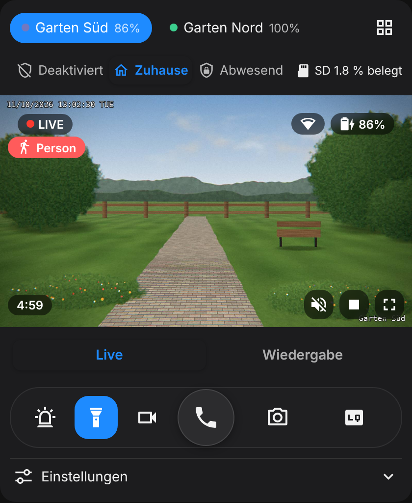
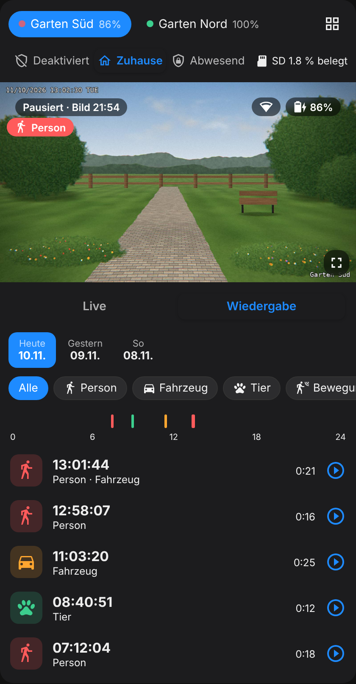
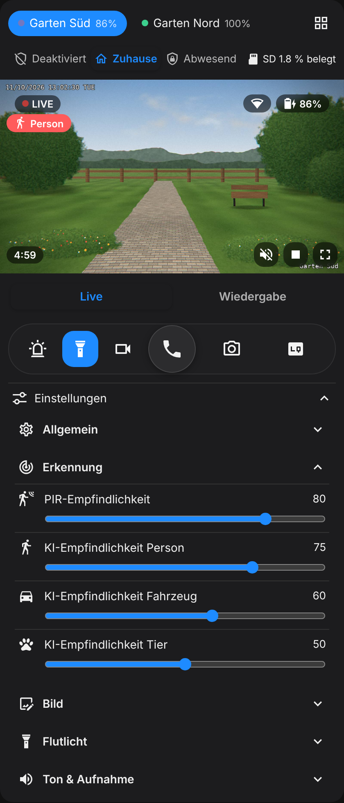

# Reolink App Card

[English](README.md) · [Deutsch](README.de.md) · **Français**

[](https://buymeacoffee.com/nion_zh)

Une carte Lovelace pour Home Assistant qui ressemble à l’app officielle Reolink : direct, commandes, réglages et lecture des enregistrements de la carte SD dans une seule carte. Conçue pour les caméras Reolink (p. ex. la série Argus sur batterie) reliées à un **Reolink Home Hub**, via l’[intégration Reolink](https://www.home-assistant.io/integrations/reolink/) officielle.

> [!IMPORTANT]
> **Nécessite un Reolink Home Hub.** La carte fonctionne uniquement avec des caméras reliées à un Reolink Home Hub (ou Home Hub Pro) et ajoutées à Home Assistant via le hub. Les caméras ajoutées directement à Home Assistant, sans hub, ne sont pas prises en charge.

<p>
  
  
  
</p>

## Fonctions

- **Vrai direct** qui démarre quand la carte est visible et se met en pause après 5 minutes (réglable) ou dès que vous quittez la vue.
- **Aperçu économe :** en pause, la carte affiche la dernière image au lieu d’interroger sans cesse la caméra sur batterie.
- **Son :** le bouton haut-parleur sur l’image active ou coupe le son de la caméra. Avec `audio: auto`, le son est activé dès que le direct démarre.
- **Interphone :** parler à travers la caméra directement depuis la carte, avec un bouton combiné et un écran d’appel comme dans l’app Reolink. Nécessite la fonction Labs « Audio bidirectionnel » de Home Assistant (2026.11+), une caméra qui la prend en charge en RTSP et un accès en **HTTPS** ; sinon le bouton est grisé.
- **Barre de commandes comme dans l’app Reolink :** parler, sirène, projecteur, enregistrement, capture et qualité (fluide, équilibrée, nette).
- **Sélecteur de mode :** mode scène du hub (désarmé / maison / absent) ou votre propre mode (`mode_entity`), plus l’occupation de la carte SD.
- **Bascule automatique** vers la caméra qui détecte une personne, un véhicule ou un animal.
- **Vue en grille** de toutes les caméras, **zoom numérique**, **réglages groupés**, **lecture** avec chronologie de 24 heures et filtres.
- **Alertes batterie** et **éditeur visuel** qui détecte les caméras automatiquement.
- **Suggestions de carte :** via *Ajouter au tableau de bord* sur une caméra Reolink (ou le hub), la carte apparaît dans les suggestions de la communauté, déjà configurée.
- **Anglais, allemand et français,** selon la langue de Home Assistant (option `language: fr` pour forcer le français).

## Installation

[](https://my.home-assistant.io/redirect/hacs_repository/?owner=niondevelop&repository=reolink-app-card&category=plugin)

1. Ouvrir **Paramètres → Marketplace** (à partir de Home Assistant 2026.11 ; avant, dans **HACS**)
2. Rechercher « Reolink App Card » et **Installer**
3. Recharger le navigateur

Si la carte n’apparaît pas encore dans la recherche, ajoutez-la vous-même : dans le Marketplace, en haut à droite, choisir **Ajouter depuis un lien** (*Add from link*), saisir `niondevelop/reolink-app-card` puis **Ajouter** (la première fois, le Marketplace demande de connecter GitHub). Avec HACS sur les versions plus anciennes : menu en haut à droite → **Dépôts personnalisés**, type **Dashboard**.

## Configuration

```yaml
type: custom:reolink-app-card
language: fr
cameras:
  - name: Entrée
    entity: camera.entree_fluent
```

Toutes les options sont décrites dans la [documentation en anglais](README.md#card-options) ; les noms des options sont identiques.

## Soutenir

Si la carte vous plaît, vous pouvez m’offrir un café. Merci !

<a href="https://buymeacoffee.com/nion_zh"></a>

## Licence

MIT
