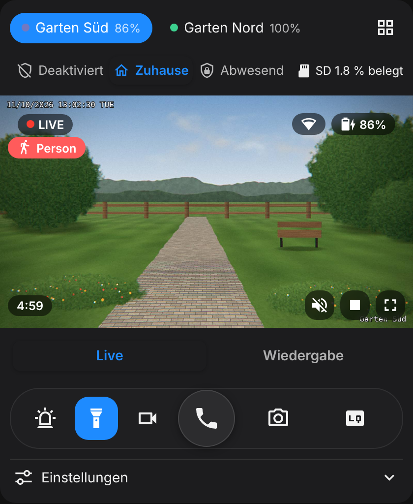
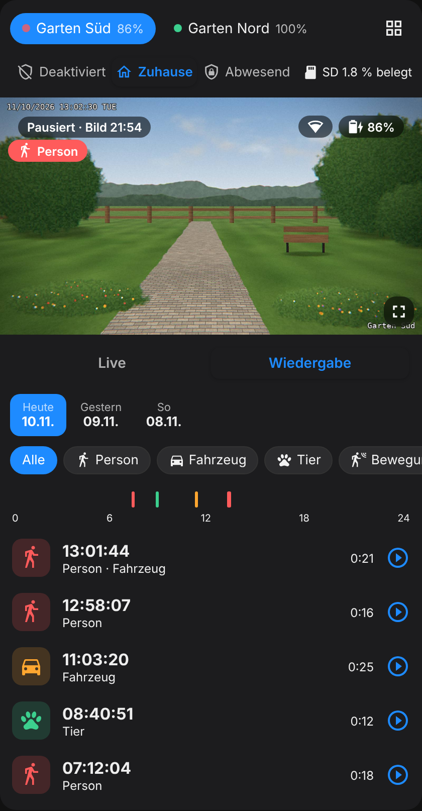
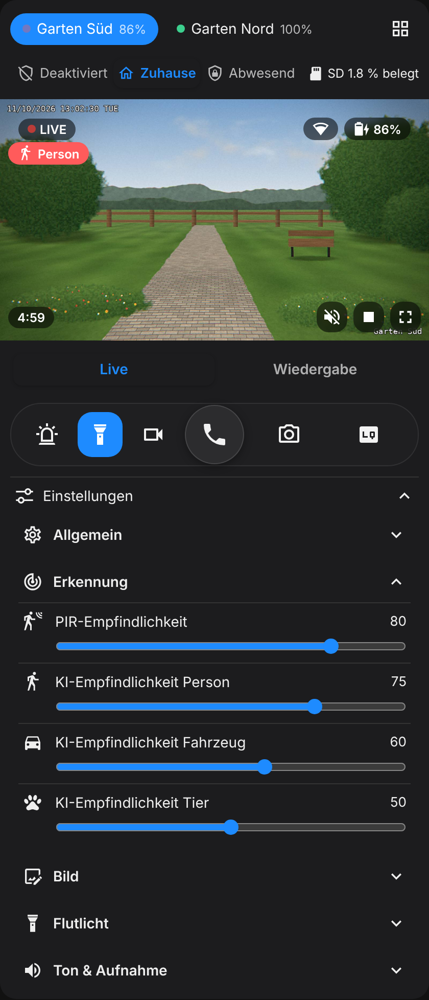
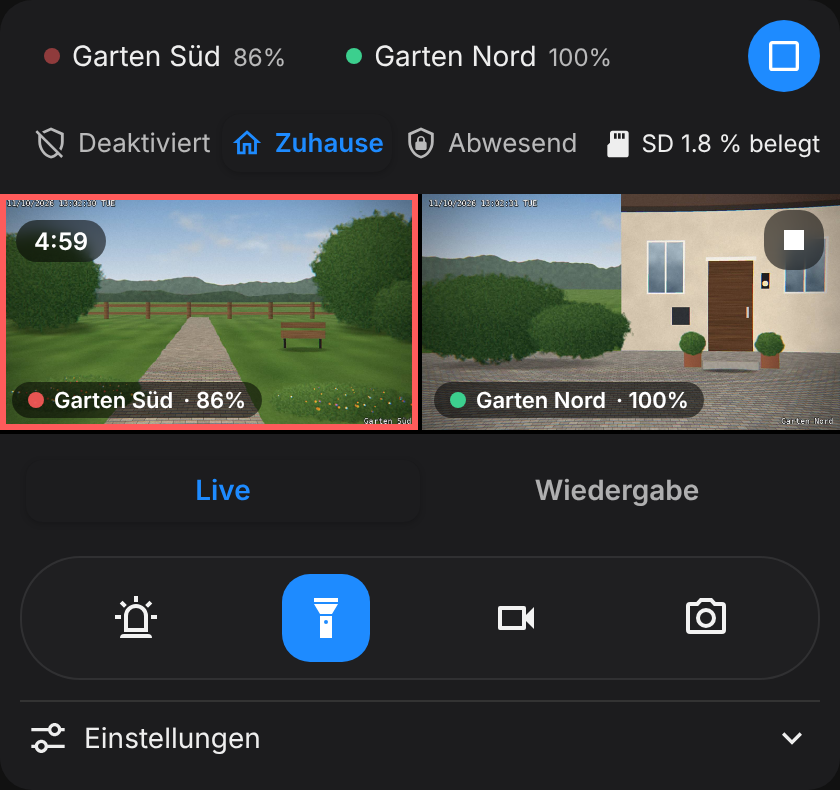

# Reolink App Card

**English** · [Deutsch](README.de.md) · [Français](README.fr.md)

[](https://github.com/hacs/integration)
[](https://github.com/niondevelop/reolink-app-card/releases)
[](https://github.com/niondevelop/reolink-app-card/actions/workflows/validate.yml)
[](https://buymeacoffee.com/nion_zh)

A Lovelace card for Home Assistant that feels like the official Reolink app: live view, controls, settings and playback of SD card recordings in a single card. Built for Reolink cameras (e.g. the battery-powered Argus series) connected to a **Reolink Home Hub**, using the official [Reolink integration](https://www.home-assistant.io/integrations/reolink/).

> [!IMPORTANT]
> **Requires a Reolink Home Hub.** The card only works with cameras that are connected to a Reolink Home Hub (or Home Hub Pro) and added to Home Assistant through the hub. Cameras connected directly to Home Assistant, without a hub, are not supported.

<p>
  
  
  
</p>

<sub>Screenshots use a drawn demo image instead of a real camera.</sub>

## Features

- **Real live view:** starts automatically when the card becomes visible and pauses after 5 minutes (configurable), or as soon as you scroll away or leave the app.
- **Battery-friendly preview:** while paused, the card shows the last image as a still instead of polling the battery camera all the time.
- **Sound:** the live view starts muted; the speaker button on the video turns the camera's sound on (stays on while you switch cameras).
- **Two-way audio:** talk through the camera right from the card, with a handset button and a call screen like in the Reolink app (Home Assistant Labs feature, see notes).
- **Control bar like the Reolink app:** talk, siren, spotlight, record, snapshot and quality (fluent, balanced, clear).
- **Mode selector on top:** either the Reolink scene mode of the hub (disarmed / home / away) or your own mode from Home Assistant (`mode_entity`), e.g. for push notifications. Plus the SD card usage.
- **Jump on detection:** when a camera detects a person, vehicle or animal, the card switches to it and shows a notice.
- **All cameras at once:** grid view with every live stream; tap one to open it.
- **Digital zoom:** pinch with two fingers, double-tap to zoom in, or ctrl + mouse wheel.
- **Grouped settings:** general, detection (PIR and AI sensitivity), image (brightness, contrast, saturation, sharpness), floodlight, audio & recording – with sliders and dropdowns.
- **Playback:** day picker, event type filter, coloured 24-hour timeline, speed (0.5× to 4×), autoplay next clip, clip download.
- **Battery warnings** for low charge and for battery temperature that is too high or too low.
- **Visual editor:** cameras are detected automatically and can be added with one click.
- **English, German and French,** following the Home Assistant language.

Entries for entities that don't exist or are disabled are hidden automatically.



## Installation

[](https://my.home-assistant.io/redirect/hacs_repository/?owner=niondevelop&repository=reolink-app-card&category=plugin)

### Marketplace / HACS

1. Open **Settings → Marketplace** (Home Assistant 2026.11 and later; on older versions open **HACS**)
2. Search for “Reolink App Card” and select **Install**
3. Reload your browser (in the Companion app: Settings → *Reset frontend cache*)

If the card doesn't show up in the search yet, add it yourself: in the Marketplace select **Add from link** in the upper-right corner, enter `niondevelop/reolink-app-card` and select **Add** (the Marketplace asks you to connect GitHub the first time). On older versions with HACS: menu at the top right → **Custom repositories**, type **Dashboard**. Once the card is in the catalog, the Marketplace switches over on its own.

The Marketplace adds the dashboard resource for you (`/local/community/reolink-app-card/reolink-app-card.js`). If you manage resources in YAML, add it there yourself.

### Manual installation

Copy `dist/reolink-app-card.js` to `/config/www/` and add it under **Settings → Dashboards → Resources** as a JavaScript module with the URL `/local/reolink-app-card.js`.

## Configuration

The easiest way is the visual editor: add card → “Reolink App Card”. Or in YAML:

```yaml
type: custom:reolink-app-card
cameras:
  - name: Front door
    prefix: front_door
    media_name: Front Door
  - name: Garden
    prefix: kamera_garten
    media_name: Garden
```

### Card options

| Option                    | Default       | Description |
| ------------------------- | ------------- | ----------- |
| `cameras`                 | –             | **Required.** List of cameras (see below) |
| `default_quality`         | `fluent`      | Start quality: `fluent`, `balanced` or `clear` |
| `live_timeout`            | `300`         | Seconds after which the live view pauses. `0` = no limit |
| `auto_live`               | `true`        | Start the live view automatically when the card becomes visible |
| `auto_switch`             | `true`        | Jump to the camera that detected something |
| `alert_seconds`           | `8`           | How long the detection notice stays visible |
| `autoplay_next`           | `true`        | Play the next clip when a clip ends |
| `battery_warning`         | `20`          | Battery warning at or below this charge (%). `0` = off |
| `temperature_warning`     | `45`          | Warning at or above this battery temperature (°C). `false` = off |
| `temperature_low_warning` | `-10`         | Warning at or below this battery temperature (°C). `false` = off |
| `mode_entity`             | –             | Your own mode selector on top of the card, e.g. an `input_select` with “Away / Home / Night / Off” for your notification automation. Replaces the Reolink scene mode there |
| `mode_icons`              | –             | Custom icons per option, e.g. `{ Night: mdi:weather-night }`. Without it, the card picks fitting icons for common names |
| `show_scene`              | `true` / `false` with `mode_entity` | Show the Reolink scene mode of the hub |
| `show_hub`                | `true`        | Show the hub row (scene mode and SD card) |
| `hub_prefix`              | `reolink_hub` | Common part of the hub entity IDs |
| `hub_entities`            | –             | Set hub entities individually: `scene`, `storage` |
| `language`                | `auto`        | `auto`, `en`, `de` or `fr` |
| `talk_url`                | –             | Optional: open this link (e.g. the Reolink app) with the talk button when two-way audio is not available. Can also be set per camera |

### Camera options

| Option       | Description |
| ------------ | ----------- |
| `prefix`     | **Required.** The common part of the entity IDs, e.g. `front_door` for `camera.front_door_fluent` |
| `name`       | Display name |
| `media_name` | Name of the camera in the Reolink media source (Media → Reolink). Needed for playback if it differs from the device name |
| `talk_url`   | Link for the talk button of this camera when two-way audio is not available |
| `entities`   | Override single entities, e.g. `entities: { light: light.my_floodlight }` |

The card finds the entities on its own, for both English and German entity IDs (e.g. `camera.<prefix>_fluent` or `camera.<prefix>_standardauflosung`). Each one can be set with `entities`. The keys are: `cam_sd`, `cam_bal`, `cam_hd`, `snap`, `light`, `siren`, `manual_rec`, `rec`, `pir`, `push`, `daynight`, `battery`, `battery_state`, `battery_temp`, `wifi`, `sleep`, `det_person`, `det_vehicle`, `det_animal`, `det_motion` and the settings `pir_sens`, `ai_person`, `ai_vehicle`, `ai_animal`, `img_bright`, `img_contrast`, `img_sat`, `img_sharp`, `anti_flicker`, `ir_bright`, `fl_mode`, `fl_bright`, `volume`, `post_rec` and more.

### Accent colour

The accent colour comes from the CSS variable `--reolink-accent` (default `#1e8bff`) and can be set in your theme.

## Notes

- **Enable entities:** many Reolink entities are disabled by default, e.g. the “balanced” and “clear” streams, the image settings and the SD sensor of the hub. Enable them under *Settings → Devices & services → Reolink → device*; they then appear in the card.
- **Battery:** every minute of live view costs battery. To save power, shorten `live_timeout` or set `auto_live: false`.
- **Two-way audio (talk):** uses the two-way audio of Home Assistant (2026.11 and later). Requirements:
  - Enable it under *Settings → System → Labs → Two-way audio*.
  - The camera must support two-way audio and Home Assistant must stream it over RTSP (Reolink integration options).
  - Open Home Assistant over **HTTPS** (e.g. from outside via Nabu Casa or your own domain). Browsers only allow the microphone on HTTPS. Over plain HTTP the button is greyed out, unless your Companion app can send the microphone itself.
  - Allow microphone access when your browser or app asks.

  Tap the handset to talk; the live view starts if needed and stays on while you talk. Tap the red button to hang up. If a requirement is missing, the button is greyed out and tapping it tells you why. With `talk_url`, the button opens that link instead whenever two-way audio is not available, e.g. `app://com.mcu.reolink` to open the Reolink app in the Android Companion app.
- **Playback:** uses the media source of the Reolink integration and prefers the low resolution, because it loads faster and saves battery.

## Support

If you like the card, you can buy me a coffee. Thank you!

<a href="https://buymeacoffee.com/nion_zh"></a>

## License

MIT
